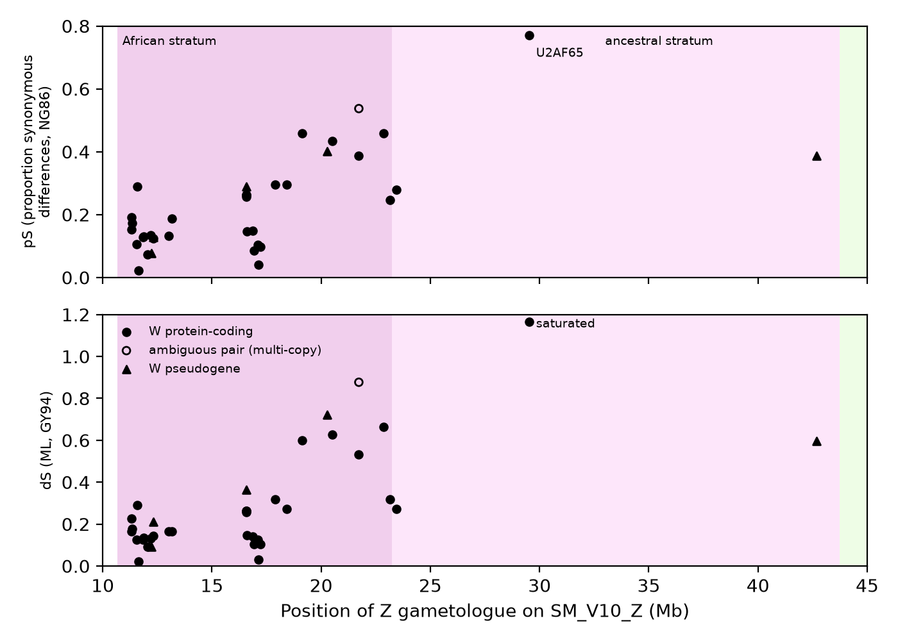

# Schistosoma mansoni V10 genome: Z-W gametologue divergence (dS) along the Z

### author: Stephen Doyle, stephen.doyle[at]sanger.ac.uk

- strata in Fig. 3a are defined from coverage; synonymous divergence between Z and W gametologues is the standard independent test - older strata stopped recombining earlier, so their gametologues should have higher dS
- uses only the V10 assembly and annotation (WBPS19), no new data
- every gene on SM_V10_WSR (33 protein-coding, 5 pseudogenes) is paired with its best match elsewhere in the genome
    - protein-coding W genes: k-mer prefilter, then local protein alignment (BLOSUM62); near-equal hits (>=95% of best score) broken by nucleotide identity
    - W pseudogenes: spliced exons from the GFF, local nucleotide alignment to candidate CDSs, codons read in the Z partner's frame
- codon alignment from the protein alignment; dN/dS by NG86, YN00 and ML (Biopython codonalign); pS = raw proportion of synonymous differences (NG86 counting), which doesn't blow up when dS saturates
- U2AF65 (Smp_348790) also split at W aa 125, because its N-terminus is divergent (Fig. 6)
- strata coordinates as in `smansoni_genome.z_strata.md`: African 10,680,112-23,250,000; ancestral 23,250,001-43,743,322

```bash
# local; scripts in 03_code/zw_gametologue_dS/
B=https://ftp.ebi.ac.uk/pub/databases/wormbase/parasite/releases/WBPS19/species/schistosoma_mansoni/PRJEA36577/schistosoma_mansoni.PRJEA36577.WBPS19
mkdir -p data
for f in genomic.fa.gz annotations.gff3.gz CDS_transcripts.fa.gz protein.fa.gz; do
    curl -sS -C - -o data/schistosoma_mansoni.PRJEA36577.WBPS19.${f} ${B}.${f}
done

uv venv .venv && uv pip install --python .venv/bin/python biopython pandas matplotlib scipy

.venv/bin/python zw_ds.py data results
.venv/bin/python plot_ds.py results/zw_gametologue_ds.tsv results/figure_ZW_gametologue_dS
```



Table: `04_analysis/zw_gametologue_ds.tsv`

## Results
- pairings: all unambiguous except histone H3 (Smp_348800; identical paralogs, Z partner uncertain - open circle, excluded from tests). The paper's pairs are recovered, including the ankyrin/KH pseudogene Smp_318710 -> Smp_158310 and U2AF65 Smp_348790 -> Smp_019690
- PAR1 fragment Smp_325490 -> Smp_153170: dS 0, as expected
- **the "African" stratum is not uniform**
    - Z genes at 11.3-18.4 Mb: median dS_ML 0.15 (n=27, incl. 3 pseudogenes)
    - Z genes at 19.1-22.8 Mb: median dS_ML 0.63 (n=5, incl. bHLH pseudogene Smp_318650)
    - Mann-Whitney p = 1e-5; Spearman rho (position vs dS) = 0.48, p = 0.005
    - best single breakpoint (SSE, protein-coding only) between 18.42 and 19.14 Mb. NB chosen after looking at the data
- **U2AF65 is by far the most diverged pair**: pS 0.77, ML dS ~2.6 (NG86 saturated). C-terminal part (aa 126-end): 97% aa identity, dN 0.013, ML dS ~2.8 - synonymous sites saturated, protein strongly conserved
- **the 23.25 Mb boundary doesn't fit**: Smp_067520 (23.14 Mb) and the DnaJ pair Smp_336770 / Smp_020920 (23.46 Mb) have dS ~0.3, lower than the 19-22.8 Mb block. The DnaJ pair sits inside the "ancestral" stratum by the coordinates above, which conflicts with "only two gametologues in the ancestral region"
- ankyrin/KH pseudogene Smp_318710 (Z partner at 42.7 Mb): dS_ML 0.60, pS 0.39 - well below U2AF. Caveat: for pseudogenes only the best local block aligns (34% of Z codons here), which biases dS down; dN/dS 0.48 is consistent with relaxed constraint after pseudogenisation
- Smp_093100 (Z, 18.4 Mb) / Smp_348830 (W) is the U2AF small-subunit gametologue mentioned in the Discussion

## Caveats
- position is on Z only; W gene order is scrambled (Fig. 4b), so this is not a W-side map
- small n beyond 19 Mb; breakpoint position is post hoc - to be tested with sexed coverage (`smansoni_genome.z_strata_v2_plan.md`)
- pseudogene dS from partial alignments

## For the manuscript
- add as a panel under Fig. 3a (dS track) or as a supplementary figure
- Results: the African stratum contains at least two steps of recombination suppression (~18.5 Mb); U2AF65 is the oldest pair
- reconcile the ancestral boundary (23.25 Mb) with the DnaJ pair at 23.46 Mb
